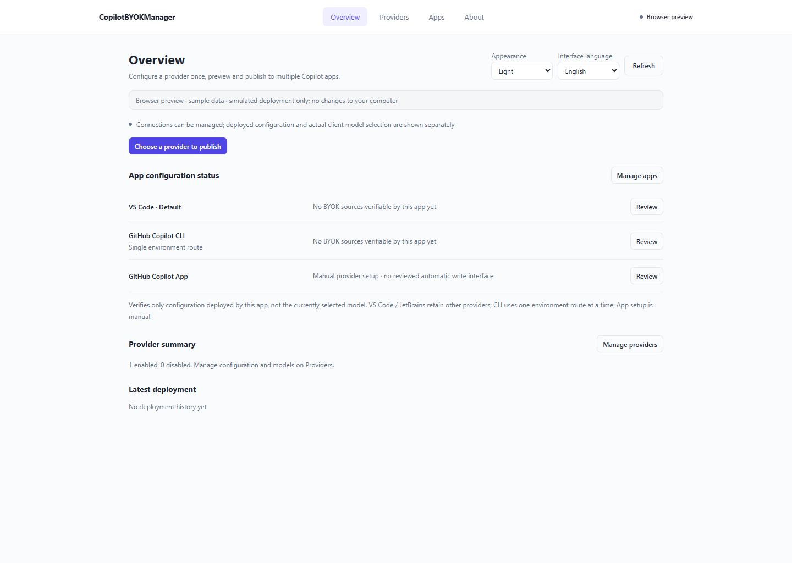
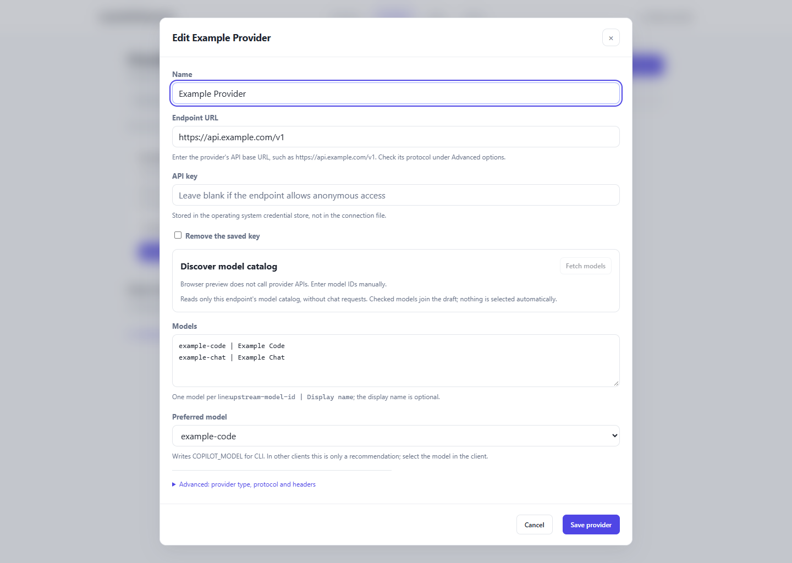
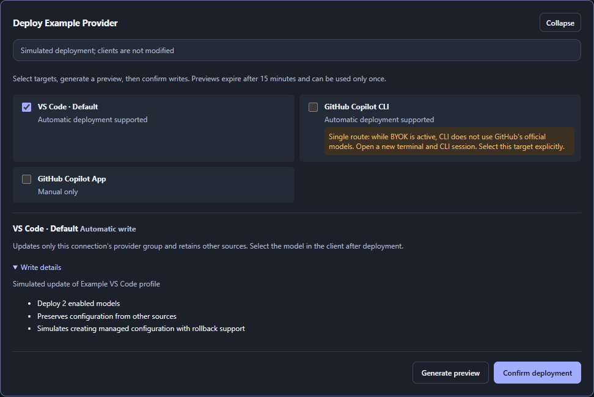

<p align="center">
  
</p>

<h1 align="center">CopilotBYOKManager</h1>

<p align="center"><strong>Configure one provider. Publish it safely across your Copilot clients.</strong></p>

<p align="center">Manage your endpoint, API key and models once, review every target change, then publish to VS Code, Copilot CLI and reviewed JetBrains versions.</p>

<p align="center">
  <a href="https://github.com/AvaloNero/CopilotBYOKManager/actions/workflows/ci.yml"></a>
  
  
  <a href="LICENSE"></a>
</p>

<p align="center">
  <a href="#download">Download status</a> · <a href="#quick-start">Quick Start</a> · <a href="#supported-clients">Supported Clients</a> · <a href="#security">Security</a> · <a href="docs/README.md">Documentation</a> · <a href="https://github.com/AvaloNero/CopilotBYOKManager/issues">Issues</a> · <a href="README.zh-CN.md">简体中文</a>
</p>

> **Pre-release.** No public installer has been released yet. Builds and automated checks do not establish clean-machine or real-client acceptance. See [current evidence](docs/implementation-status.md) and [release gates (中文)](docs/release-criteria.md).



*Current four-page interface, simulated browser preview. No real accounts, keys or client writes. [Capture details](docs/images/README.md).*

## Why CopilotBYOKManager

- **One place for providers.** Maintain endpoint, key and models together, then choose where to publish them.
- **Review across clients.** Inspect changes for every selected app or profile before writing.
- **Respect existing configuration.** Manage only verified owned configuration; external changes block destructive replacement.

## How it works

**Add a provider → Review targets and changes → Publish, select the model, verify.**

Saving, publishing, selecting a model, and completing a request are four different states. Client sign-in is separate; the manager does not share login credentials.

<a id="supported-clients"></a>

## Supported clients

These are implemented configuration paths, **not runtime-accepted compatibility claims**. Real-client acceptance is pending.

| Client | Mode | Current boundary and next step |
| --- | --- | --- |
| VS Code Stable / Insiders / profiles | Automatic | Owned provider groups. Select the model in the correct profile, then test. [Detection details](docs/vscode-detection.md) |
| GitHub Copilot CLI | Automatic | One environment route. Open a new terminal/session and verify the route/model. [Client guide](docs/user-guide.md#5-select-and-verify-the-model-in-each-client) |
| Reviewed JetBrains GitHub Copilot distributions | Automatic, version-pinned | Close/reopen IDEs, sign in separately, select and test. [Exact reviewed versions](docs/jetbrains-support.md#version-and-compatibility-boundary) |
| GitHub Copilot App | Manual | No automatic provider writes or verification. Configure and verify inside the App. [Guide](docs/user-guide.md#5-select-and-verify-the-model-in-each-client) |

No JetBrains version is advertised as runtime-accepted yet. Unknown/newer versions are unsupported; IDEs sharing a runtime directory may see the same configuration. Client policies, subscriptions and provider access requirements still apply.

<a id="download"></a>

## Download and install

Watch [Releases](https://github.com/AvaloNero/CopilotBYOKManager/releases) for an approved candidate. These are planned packages, not existing download links:

| Platform | Package | Status |
| --- | --- | --- |
| Windows 11 x64 | `CopilotBYOKManager-vX.Y.Z-windows-x64-setup.exe` | Candidate; clean-machine acceptance pending. **Unsigned community build** |
| Windows 11 x64, optional | `CopilotBYOKManager-vX.Y.Z-windows-x64-standalone.zip` | Same acceptance boundary; WebView2 required |
| macOS Universal | `CopilotBYOKManager-vX.Y.Z-macos-universal.dmg` | Planned; Apple credentials and Intel / Apple Silicon acceptance pending. Formal packages must be **Developer ID signed and notarized** |

Windows Setup installs for the current user. macOS packaging starts at 15.0: a conservative build floor, not a tested support claim. Test DMGs use `*-testing-adhoc.dmg`: **Ad-hoc signed, not notarized; testing only**.

Check `SHA256SUMS.txt` and the source SHA before installing. Standalone means no installer, **not fully portable**: state, OS credentials and client configuration still use user storage. [Package guide](docs/release-engineering.md).

To explore now, open [the current browser frontend](apps/desktop/web/index.html) from a local source checkout. It uses sample data and performs no native writes. Use fictitious values, not real keys.

<a id="quick-start"></a>
<a id="getting-started"></a>
<a id="first-connection"></a>

## Quick start

1. In **Providers**, add the provider endpoint and API key.
2. Fetch models or enter model IDs manually; save the provider.
3. Select your apps/profiles. CLI requires explicit selection.
4. Review the native preview, confirm publication, and read each target's result.
5. Select the model in the client and send a minimal, non-sensitive test request.

Catalog access tests the model list, not chat or tools. Requests may incur charges. See the [English user guide](docs/user-guide.md) or [中文手册](docs/user-guide.zh-CN.md) for fields, client steps, updates, revocation and recovery.

## Core features

| Feature | What it gives you |
| --- | --- |
| Central provider profiles | Endpoint, protocol, key reference, catalog and preferred model |
| Multi-client publication | Explicit targets and persistent per-target results |
| Review before write | Native-held, expiring, one-use plans and live target checks |
| Ownership-aware revoke | Remove owned configuration, preserve other providers |
| Crash-safe recovery | Private write-ahead records, conditional rollback and explicit recovery |
| Local credentials and bilingual UI | OS-held master keys; English / 简体中文; Light / Dark / System |

**Overview · Providers · Apps · About.** [Window and appearance behavior](docs/user-guide.md#current-pages) includes the implemented Windows tray preference; native desktop acceptance is still pending.

<a id="security"></a>

## Safety and privacy

- Never copies client OAuth tokens, cookies, SecretStorage or Password Safe.
- Stores provider master keys in the OS credential store.
- Some client formats require provider keys in on-disk configuration.
- Previews natively and rechecks targets before writing.
- Refuses destructive overwrite, revocation or rollback after external changes.
- Recovery data may contain sensitive configuration: do not upload it.
- No default telemetry or conversation upload.

Read [SECURITY.md](SECURITY.md) before sharing diagnostics. Use the [security page](https://github.com/AvaloNero/CopilotBYOKManager/security) for vulnerabilities, privately when that channel is enabled.

<a id="usage"></a>

## Known limits

- CLI uses one managed environment route, not simultaneous provider routing.
- Copilot App is manual; JetBrains is limited to exact reviewed distributions.
- Written configuration is not proof of sign-in, model selection or a successful request.
- Usage, Billing and Resources/MCP/Skills/Instructions are outside this edition. Existing data remains intact. [Feature availability](docs/feature-availability.md).
- Clean Windows, native tray behavior, real requests and both Mac architectures remain **acceptance pending**. Rider validation is deferred.

## Screenshots

All images show the current browser frontend with **simulated data**, not real-client acceptance. Overview appears above.

| Provider editor · Light | Publication preview · Dark |
| --- | --- |
|  |  |

## Sponsors

No sponsors or payment links are currently listed. Sponsorship will not determine compatibility results or make a provider the default.

<a id="everyday-use"></a>
<a id="faq"></a>

## Documentation and support

[User guide](docs/user-guide.md) · [中文手册](docs/user-guide.zh-CN.md) · [Documentation index](docs/README.md) · [Model catalogs](docs/provider-model-discovery.md) · [Implementation evidence](docs/implementation-status.md) · [Release engineering](docs/release-engineering.md)

Use [Issues](https://github.com/AvaloNero/CopilotBYOKManager/issues) with versions, steps and redacted statuses. The [release criteria](docs/release-criteria.md), [local validation plan](docs/local-validation-plan.md) and [promotion plan](docs/promotion-plan.md) are in Chinese; the [release guide](docs/release-engineering.md) covers maintainer steps in English.

<details>
<summary>Development / Build from source</summary>

CI uses Node 22, Rust 1.88.0 and [Tauri system dependencies](https://v2.tauri.app/start/prerequisites/). Windows needs MSVC/WebView2; macOS needs Xcode command-line tools. Read [AGENTS.md](AGENTS.md), [the specification](docs/mvp-implementation-spec.md) and [architecture](docs/architecture.md).

```bash
git clone https://github.com/AvaloNero/CopilotBYOKManager.git
cd CopilotBYOKManager
npm ci
npm run dev
npm run check
git diff --check
```

`main` is the development branch. `npm run build -- --no-bundle -- --locked` builds only the app. NSIS / Universal DMG and dry-run instructions: [release engineering](docs/release-engineering.md).

</details>

## License and disclaimer

[MIT](LICENSE). Independent community project; not affiliated with, sponsored by or endorsed by GitHub or JetBrains. Their names and marks belong to their respective owners. The manager does not host models, supply subscriptions or provide free credits.
