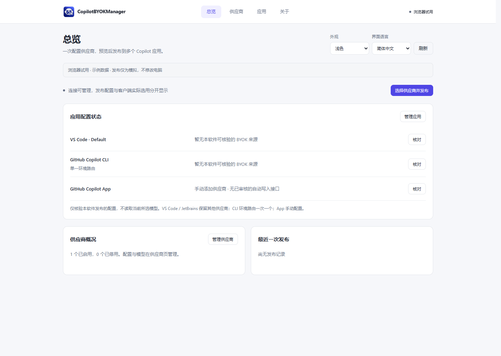
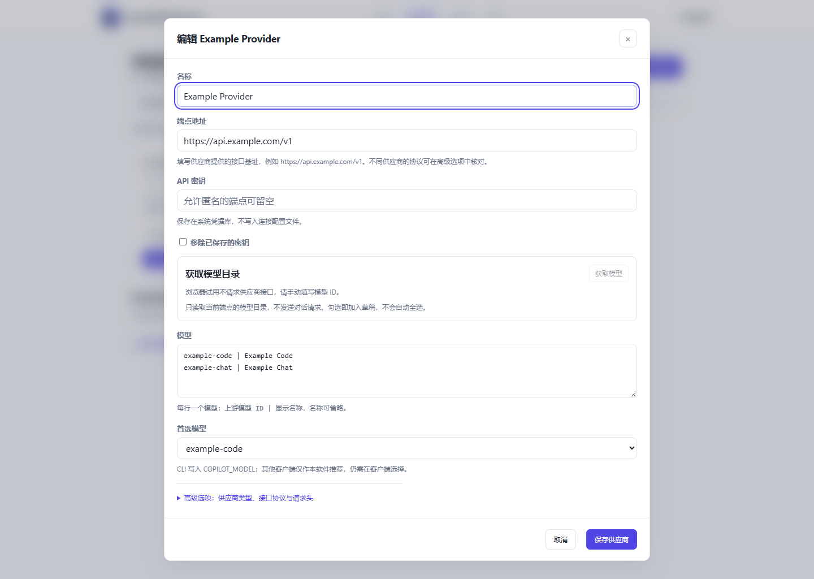
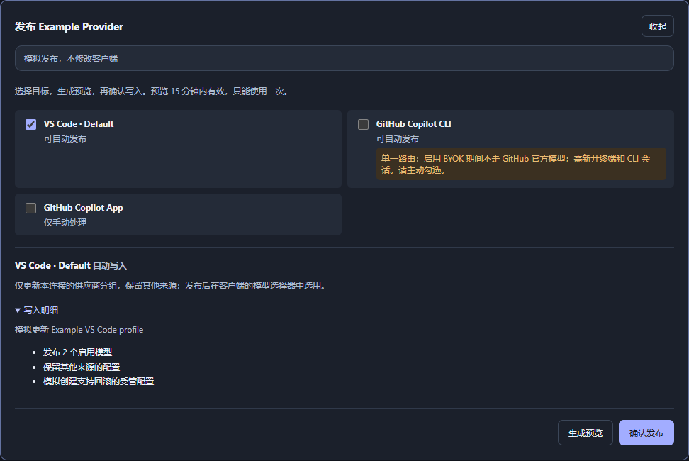

<p align="center">
  
</p>

<h1 align="center">CopilotBYOKManager</h1>

<p align="center"><strong>Provider 一次配置，安全发布到多个 Copilot 客户端。</strong></p>

<p align="center">集中管理端点、密钥和模型，逐项预览目标改动，再发布到 VS Code、Copilot CLI 与已审核版本的 JetBrains。</p>

<p align="center">
  <a href="https://github.com/Arcueid77/CopilotBYOKManager/actions/workflows/ci.yml"></a>
  
  
  <a href="LICENSE"></a>
</p>

<p align="center">
  <a href="#download">下载状态</a> · <a href="#quick-start">快速上手</a> · <a href="#supported-clients">支持客户端</a> · <a href="#security">安全</a> · <a href="docs/README.md">文档</a> · <a href="https://github.com/Arcueid77/CopilotBYOKManager/issues">问题反馈</a> · <a href="README.md">English</a>
</p>

> **预发布阶段。** 尚未公开发行安装包。见[当前证据](docs/implementation-status.md)与[发布门槛](docs/release-criteria.md)。



*当前四页界面，使用模拟数据；没有真实账号、密钥或客户端写入。[截图说明](docs/images/README.md)。*

## 为什么使用 CopilotBYOKManager

- **Provider 在一处维护。** 地址、密钥和模型放在一起，再选择要发布的应用。
- **多客户端预览后发布。** 写入之前，逐项检查所选应用与档案的变化。
- **尊重已有配置。** 只管理能核验归属的配置；外部变化会阻止破坏性覆盖。

## 工作方式

**添加供应商 → 核对目标和改动 → 发布、选用模型、验证。**

在各客户端完成登录，选用发布的模型即可开始使用。

<a id="supported-clients"></a>

## 支持客户端

支持以下客户端的供应商配置：

| 客户端 | 方式 | 当前边界与下一步 |
| --- | --- | --- |
| VS Code Stable / Insiders / 配置档案 | 自动 | 受管供应商分组。在对应档案选用模型并测试。[检测细节](docs/vscode-detection.md) |
| GitHub Copilot CLI | 自动 | 确认后替换当前环境配置。完成后新开终端和会话。[客户端手册](docs/user-guide.zh-CN.md#5-到客户端里选用并验证) |
| 已审核的 JetBrains GitHub Copilot 插件发行版 | 自动，固定版本 | 关闭后重开 IDE，分别登录、选用和测试。[确切版本表](docs/jetbrains-support.md#version-and-compatibility-boundary) |
| GitHub Copilot App | 手动 | 无自动写入或验证，在 App 内配置并核对。[指引](docs/user-guide.zh-CN.md#5-到客户端里选用并验证) |

JetBrains 支持上方版本表中列出的插件发行版；共用运行时目录的 IDE 可能看到同一份配置。客户端政策、订阅和供应商权限要求仍然适用。

<a id="download"></a>

## 下载与安装

经批准的候选版会出现在 [Releases](https://github.com/Arcueid77/CopilotBYOKManager/releases)。以下是计划产物，并非已有下载链接：

| 平台 | 安装包 | 状态 |
| --- | --- | --- |
| Windows 11 x64 | `CopilotBYOKManager-vX.Y.Z-windows-x64-setup.exe` | 候选版；干净机验收待完成。**Unsigned community build（未签名社区构建）** |
| Windows 11 x64，可选 | `CopilotBYOKManager-vX.Y.Z-windows-x64-standalone.zip` | 验收边界相同；需要 WebView2 |
| macOS Universal | `CopilotBYOKManager-vX.Y.Z-macos-universal.dmg` | 计划中；Apple 凭据、Intel / Apple Silicon 验收待完成。正式包必须 **Developer ID signed and notarized（签名并公证）** |

Windows Setup 安装到当前用户。macOS 安装包目标版本为 15.0 及以上。测试 DMG 使用 `*-testing-adhoc.dmg`：**Ad-hoc signed, not notarized; testing only（临时签名、未公证，仅供测试）**。

**macOS 测试包现已可取用**：打开[已通过的测试构建附件](https://github.com/Arcueid77/CopilotBYOKManager/actions/runs/38706651589)，下载 `release-dry-run-…`，其中含 Universal DMG、`SHA256SUMS.txt` 和源码记录（`dad7bd4`）。测试包采用临时签名，未公证。如有提示请登录 GitHub；按当前工作流设置，附件保留 14 天。

安装前核对 `SHA256SUMS.txt` 与源码 SHA。Standalone 为免安装版；状态、系统凭据和客户端配置使用用户存储。[安装包说明（英文）](docs/release-engineering.md)。

现在即可从本地源码打开[当前浏览器前端](apps/desktop/web/index.html)。它使用示例数据，不执行原生写入；请填写虚构数据，不要输入真实密钥。

<a id="quick-start"></a>
<a id="getting-started"></a>
<a id="first-connection"></a>

## 快速上手

1. 在 **供应商**添加 Provider 地址与 API 密钥。
2. 获取模型目录或手动填写模型 ID，保存供应商。
3. 选择需要配置的应用与档案；CLI 需要主动勾选。
4. 核对原生预览，确认发布，查看逐目标结果。
5. 在客户端选用模型，发送一条不含敏感内容的最小测试请求。

真实请求可能产生费用。字段、客户端步骤、更新、撤销和恢复见[中文手册](docs/user-guide.zh-CN.md)与[English guide](docs/user-guide.md)。

## 核心功能

| 功能 | 提供什么 |
| --- | --- |
| 集中管理供应商 | 端点、协议、密钥引用、模型目录和首选模型 |
| 多客户端发布 | 明确选择目标，保留逐目标结果 |
| 写入前审核 | 原生持有、到期失效、单次消费的计划与目标重检 |
| 按归属撤销 | 仅清理受管配置，保留其他供应商 |
| 中断后安全恢复 | 私有写前日志、条件回滚与明确恢复入口 |
| 本地凭据与双语界面 | 系统凭据库保存主密钥；中英文；浅色 / 深色 / 跟随系统 |

**总览 · 供应商 · 应用 · 关于。**[窗口与外观说明](docs/user-guide.zh-CN.md#当前四个页面)包含 Windows 托盘选项。

<a id="security"></a>

## 安全与隐私

- 不复制客户端 OAuth Token、Cookie、SecretStorage 或 Password Safe。
- Provider 主密钥保存在系统凭据库。
- 部分客户端格式要求将 Provider Key 写入磁盘配置。
- 写入前生成原生预览，并再次核对目标。
- 外部变化后拒绝破坏性覆盖、撤销或回滚。
- 恢复数据可能含敏感配置，不得上传。
- 不添加默认遥测或对话上传。

分享诊断前阅读 [SECURITY.md](SECURITY.md)。漏洞通过[安全页面](https://github.com/Arcueid77/CopilotBYOKManager/security)反馈；开启私密报告时，请使用私密渠道。

<a id="usage"></a>

## 已知限制

- CLI 当前为单条受管环境路由，不是多供应商同时路由。
- Copilot App 需要手动配置；JetBrains 仅限确切审核过的插件发行版。
- Usage、Billing、Resources/MCP/Skills/Instructions 不属于本核心版。已有数据保留。[功能记录](docs/feature-availability.md)。
- 干净 Windows、原生托盘、真实请求及两种 Mac 架构均**待验收**。Rider 验收继续延期。

## 界面截图

全部来自当前浏览器前端，使用**模拟数据**。总览见首屏。

| 供应商编辑 · 浅色 | 发布预览 · 深色 |
| --- | --- |
|  |  |

## 赞助

目前未列出赞助商或付款链接。赞助不会影响兼容性测试结论，也不会让供应商自动成为默认项。

<a id="everyday-use"></a>
<a id="faq"></a>

## 文档与支持

[用户手册](docs/user-guide.zh-CN.md) · [English guide](docs/user-guide.md) · [文档索引](docs/README.md) · [模型目录](docs/provider-model-discovery.md) · [实现证据](docs/implementation-status.md) · [发行工程（英文）](docs/release-engineering.md)

使用问题提交 [Issues](https://github.com/Arcueid77/CopilotBYOKManager/issues)，附版本、步骤和脱敏状态。[发布标准](docs/release-criteria.md)、[本机验证计划](docs/local-validation-plan.md)和[推广计划](docs/promotion-plan.md)保留详细中文说明。

<details>
<summary>开发 / 从源码构建</summary>

CI 使用 Node 22、Rust 1.88.0 与 [Tauri 系统依赖](https://v2.tauri.app/start/prerequisites/)。Windows 需要 MSVC/WebView2；macOS 需要 Xcode 命令行工具。修改前阅读 [AGENTS.md](AGENTS.md)、[规范](docs/mvp-implementation-spec.md)和[架构](docs/architecture.md)。

```bash
git clone https://github.com/Arcueid77/CopilotBYOKManager.git
cd CopilotBYOKManager
npm ci
npm run dev
npm run check
git diff --check
```

开发分支为 `main`。`npm run build -- --no-bundle -- --locked` 只构建应用。NSIS / Universal DMG 和 dry-run 步骤见[发行工程（英文）](docs/release-engineering.md)。

</details>

## 许可证与声明

[MIT](LICENSE)。独立社区项目，与 GitHub、JetBrains 无隶属、赞助或背书关系；相关名称和商标属于各自权利人。本软件不托管模型、不提供订阅或免费额度。
